

  

  <h3>🌐 <a href="https://n-zik.vercel.app/">Official Website</a></h3>
  

    <b>N-Zik Theme Store</b> is the community appearance catalog for <a href="https://github.com/N-Zik-Group/N-Zik">N-Zik on Android</a>.
  

  

    Find theme configurations and preview images for the player, queue and navigation.
  

# 🎨 Browse themes

The [catalog index](catalog/index.json) lists the current revision of each theme. Its manifest shows the author, included files, license and minimum compatible N-Zik version. The six built-in presets are listed while release compatibility is pending.

## 📚 Documentation

[Theme format and repository layout](docs/theme-format.md) · [Contribution guide](CONTRIBUTING.md)

## 🌍 Community

Join the N-Zik Discord:

# 🎧 Features

- Versioned themes for colors, the player and queue, navigation, and Glass.
- Appearance categories that can be applied individually by compatible versions of N-Zik.
- Community submissions and updates published after manual review.

# 📷 Screenshots

Compare the six built-in presets in Normal and Glass mode. All screenshots use the same demonstration track and artwork.

<h3 align="center"><a href="themes/99edc843-6a9b-5753-8e76-cc11fe9b3295/1/manifest.json">Blurred Cover</a></h3>

  <a href="docs/previews/blurred-cover.webp">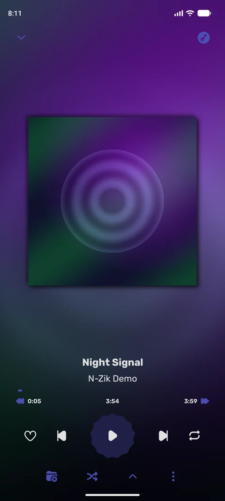</a>
  <a href="docs/previews/blurred-cover-glass.webp">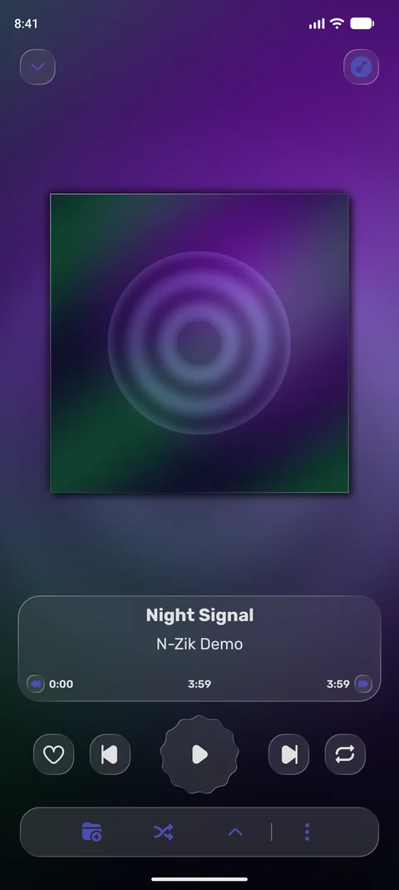</a>
   
  <b>Normal</b> · <b>Glass</b>

<h3 align="center"><a href="themes/8f13dfe9-5dc9-5dc3-b563-aa9f11cf67b7/1/manifest.json">Carousel</a></h3>

  <a href="docs/previews/carousel.webp">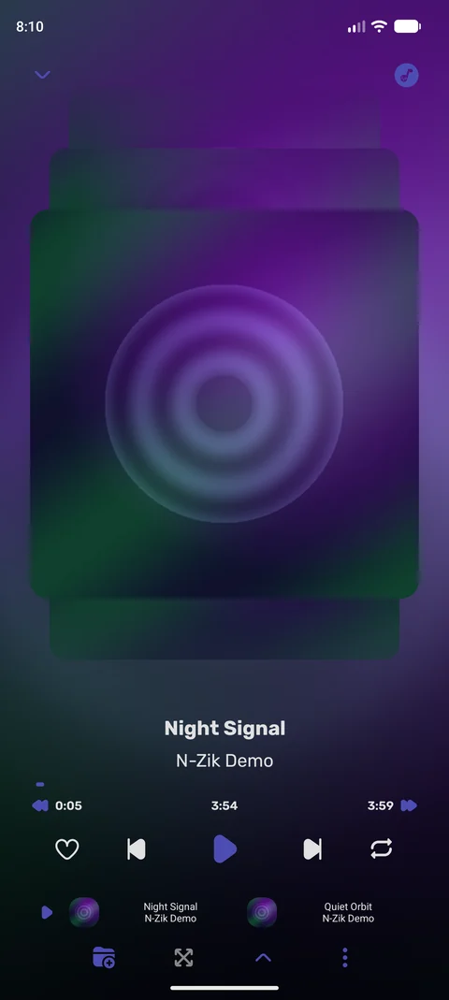</a>
  <a href="docs/previews/carousel-glass.webp">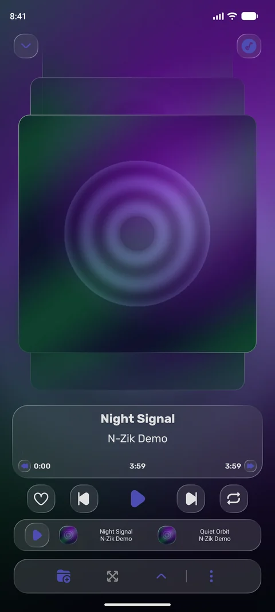</a>
   
  <b>Normal</b> · <b>Glass</b>

<h3 align="center"><a href="themes/8d06299d-a4c1-5dc7-bf21-8694af77ae36/1/manifest.json">Coverless</a></h3>

  <a href="docs/previews/coverless.webp">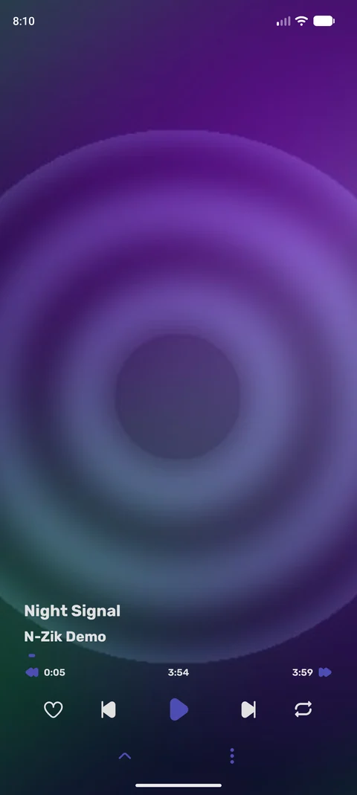</a>
  <a href="docs/previews/coverless-glass.webp">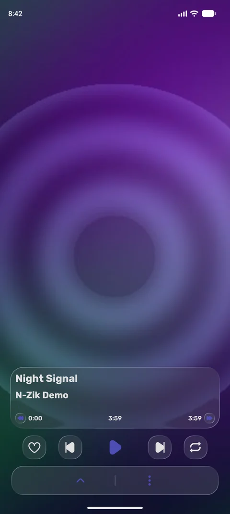</a>
   
  <b>Normal</b> · <b>Glass</b>

<h3 align="center"><a href="themes/e9fb0ce8-3b8d-5c96-9d00-f4d5f1fdcf4a/1/manifest.json">Audio Waves</a></h3>

  <a href="docs/previews/audio-waves.webp">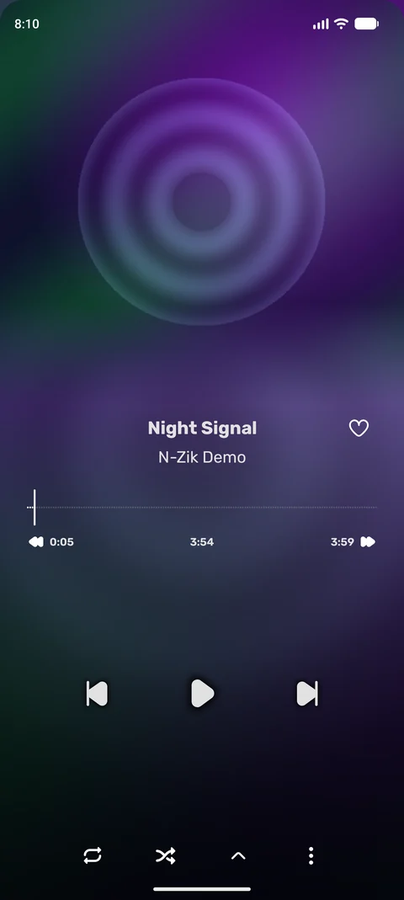</a>
  <a href="docs/previews/audio-waves-glass.webp">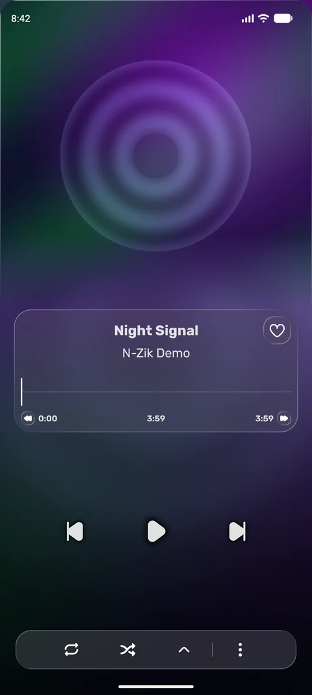</a>
   
  <b>Normal</b> · <b>Glass</b>

<h3 align="center"><a href="themes/1a59f7da-312a-52a4-93f3-8e469a987709/1/manifest.json">Pitch Black Gradient</a></h3>

  <a href="docs/previews/pitch-black-gradient.webp">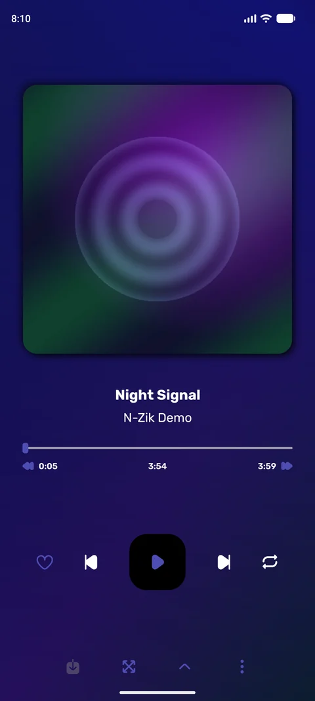</a>
  <a href="docs/previews/pitch-black-gradient-glass.webp">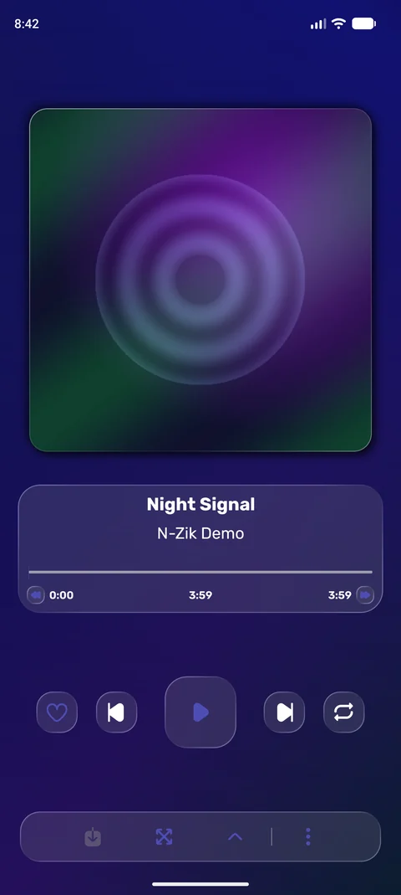</a>
   
  <b>Normal</b> · <b>Glass</b>

<h3 align="center"><a href="themes/481186ac-8178-55b6-a20d-a01dbc5efe64/1/manifest.json">Artwork Gradient</a></h3>

  <a href="docs/previews/artwork-gradient.webp">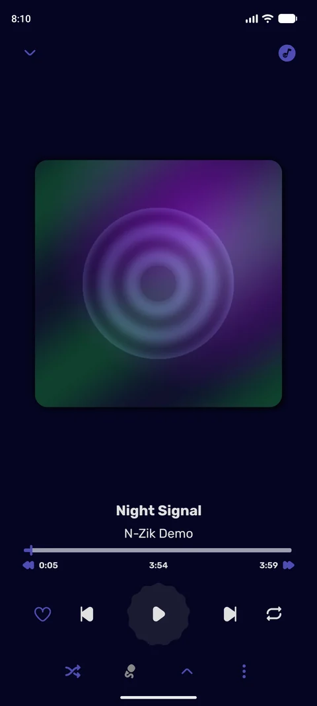</a>
  <a href="docs/previews/artwork-gradient-glass.webp">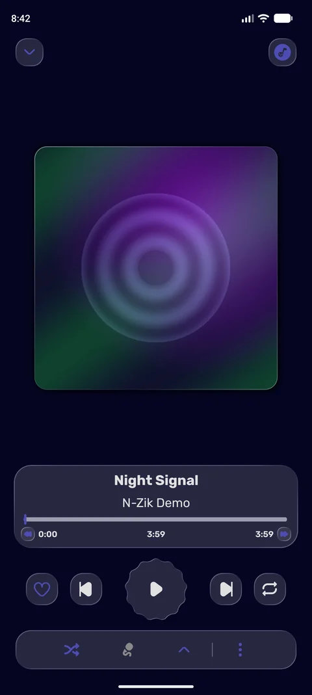</a>
   
  <b>Normal</b> · <b>Glass</b>

# 🤝 Contributing

See [CONTRIBUTING.md](CONTRIBUTING.md) to submit, update or withdraw a theme. See the [code of conduct](CODE_OF_CONDUCT.md) and [security policy](SECURITY.md) for community standards and private reporting.

# 👀 Status

## 🛠️ Catalog checks

Run `uv run --no-project --with-requirements requirements-validation.txt python scripts/validate_catalog.py` from the repository root. It checks the schemas, index, example and indexed revisions, including matching IDs, duplicate entries or preview paths, and file hashes.

## 🔄 Automation & Maintenance

# 👥 Contributors

<!-- project-contributors:start -->

<!-- project-contributors:end -->

See the [repository contributors](https://github.com/N-Zik-Group/N-Zik-Theme-Store/graphs/contributors). The original presets were introduced by [aneesh1122](https://github.com/N-Zik-Group/N-Zik/commit/ea40544986).

# 🎖️ Credits

Made with ❤️ by the N-Zik Group community · Project license: GPLv3 - see [LICENSE](LICENSE). Each theme declares its own license in its manifest.
